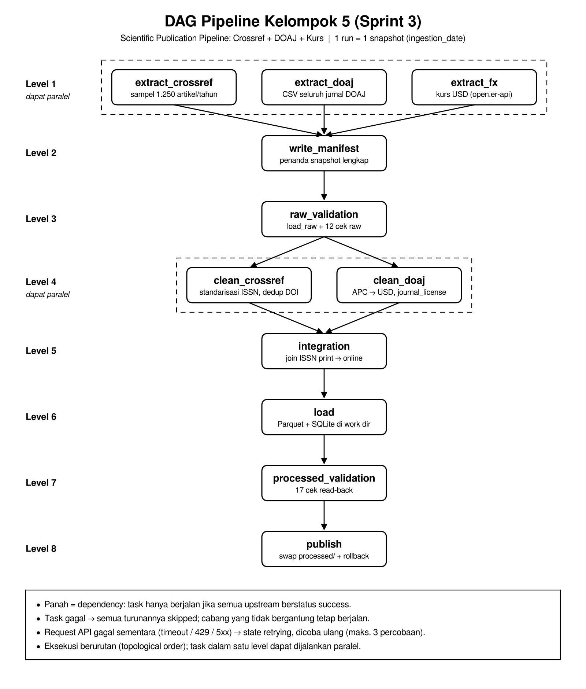

# Scientific Publication Pipeline — Kelompok 5

Mini project Data Engineering (A), Teknologi Informasi Universitas Udayana.
Dosen: Dr. Eng. Desy Purnami Singgih Putri, S.Si., M.Sc.

| Nama | NIM |
|---|---|
| I Made Ray Adhya Khrisna | 2305551003 |
| Ida Bagus Komang Adi Prayista | 2305551070 |
| Nolan Mahotama Abipantara Urya Gotama | 2305551111 |

## 1. Use case
Menggabungkan metadata artikel ilmiah (Crossref) dengan data jurnal open access (DOAJ) dan kurs (ExchangeRate-API) agar setiap artikel sampel dapat dicek: apakah jurnalnya terdaftar di DOAJ, apa lisensinya, dan berapa APC-nya dalam USD.
Grain output: **1 baris = 1 artikel (DOI unik)**.

## 2. Sumber data & integration key
| Sumber | Endpoint | Cara ambil | Peran |
|---|---|---|---|
| Crossref REST API | `api.crossref.org/works` | stratified random sampling: 1.250 artikel per tahun terbit, 2011 s.d. tahun snapshot | fakta artikel (grain) |
| DOAJ | `doaj.org/csv` | seluruh CSV jurnal | lookup per jurnal (`doaj_id`) |
| ExchangeRate-API | `open.er-api.com/v6/latest/USD` | kurs USD terbaru | konversi APC ke USD |

Integration key: **Print ISSN**, lalu **Online ISSN** bila Print ISSN tidak cocok. LEFT JOIN Crossref ← DOAJ dengan `validate="many_to_one"` (N artikel : 1 jurnal). ISSN DOAJ yang dipakai lebih dari satu jurnal tidak dipakai sebagai key. Hasil join dicatat di `match_status`: `matched_print_issn`, `matched_online_issn`, `ambiguous_issn`, `no_issn`, `not_matched_to_doaj`.

## 3. Arsitektur
```
Crossref API ─┐
DOAJ CSV ─────┼─► raw/ (apa adanya + manifest) ─► raw_validation ─► clean_crossref ┐
Kurs API ─────┘                                                  └► clean_doaj ─────┴─► integration
   ─► load (Parquet + SQLite di work/<run_id>) ─► processed_validation (quality gate) ─► publish
   ─► processed/ atau processed_backfill/snapshot_date=<tgl>/      log & metadata ─► logs/
```
11 task dalam `PIPELINE_DAG` (8 level), dijalankan berurutan sesuai topological order. Diagram DAG:


## 4. Struktur folder (Google Drive: `MyDrive/kelompok5_publication_pipeline/`)
```
raw/
  crossref/ingestion_date=<tgl>/crossref_<tahun>.jsonl.gz
  doaj/ingestion_date=<tgl>/doaj_journals.csv
  fx_rates/ingestion_date=<tgl>/fx_rates_usd.json
  _manifests/manifest_<tgl>.json        ← penanda snapshot lengkap
staging/                                 ← Crossref yang sudah di-flatten (CSV)
processed/                               ← snapshot terbaru
  articles_enriched/issued_year=<tahun>/ ← Parquet dipartisi per tahun terbit
  journals_doaj.parquet, journal_license.parquet, fx_rates.parquet
  publications.db                        ← SQLite (articles, journals_doaj, journal_license, fx_rates, pipeline_runs)
processed_backfill/snapshot_date=<tgl>/  ← hasil backfill, terpisah dari processed/
logs/
  task_runs.csv, task_events.csv, pipeline_run_history.csv
  monitoring_summary.csv, alerts.csv
  quality_reports/quality_report_<run_id>.csv
  run_metadata/run_metadata_<run_id>.json
requirements.txt                         ← ditulis notebook (Bagian 13)
```
README ini disimpan di repository GitHub, tidak di folder Drive.

## 5. Cara menjalankan
1. Buka notebook di Google Colab.
2. Buat secret `CROSSREF_EMAIL` di panel 🔑 **Secrets** (isi: email untuk polite pool Crossref) dan aktifkan **Notebook access**. Email tidak ditulis di kode.
3. Atur `INGESTION_DATE` di sel konfigurasi (lihat bagian 6).
4. Jalankan **Runtime → Restart and run all**. Notebook meminta izin mount Google Drive.

Dependency: `pip install -r requirements.txt`. File ini ditulis oleh notebook (Bagian 13) dari versi package yang benar-benar terpasang di Colab saat run.

## 6. Parameter & mode run
| Parameter / fungsi | Arti |
|---|---|
| `INGESTION_DATE = None` | snapshot = tanggal hari ini (WITA); data diambil dari ketiga API |
| `INGESTION_DATE = "YYYY-MM-DD"` | memproses ulang snapshot raw yang sudah lengkap, tanpa request ke API |
| `run_pipeline(snapshot_date)` | satu entry point untuk seluruh DAG; mengembalikan ringkasan run |
| `scheduled_run()` | entry point untuk scheduler: `run_pipeline(<tanggal hari ini WITA>)` |
| schedule | `0 9 1 * *` Asia/Makassar (tanggal 1 setiap bulan, 09:00 WITA) — **didefinisikan, belum diaktifkan** |

Aturan 1 snapshot = 1 hari: snapshot yang belum lengkap hanya boleh diambil pada tanggal snapshot itu sendiri, karena ketiga sumber hanya menyediakan kondisi saat ini. Tanggal lain ditolak (`SnapshotDateError`) sebelum task pertama berjalan.

`run_type` ditentukan otomatis: `normal` (snapshot terbaru, run pertama), `rerun` (snapshot terbaru yang pernah di-run), `backfill` (snapshot lebih lama dari snapshot lengkap terbaru).

## 7. Quality rules
Quality gate dijalankan pada kandidat output di `work/<run_id>` **sebelum** publish.
- **STOP** (gagal → run berhenti, processed lama tidak diganti):
  - 12 cek raw validation: jumlah artikel per tahun = kuota, total artikel dan baris DOAJ = manifest, DOI tidak kosong, kolom ISSN dan kolom kunci DOAJ ada, DOAJ ≥ 20.000 baris, judul jurnal tidak kosong, basis kurs USD, ≥ 100 mata uang, kurs > 0, kurs USD = 1.
  - 17 cek read-back pada Parquet + SQLite kandidat: row count = hasil transform, DOI tidak NULL dan tidak duplikat, schema kolom, kolom wajib tidak NULL, konsistensi `match_status`/`doaj_id`, foreign key, DOI Parquet = DOI SQLite.
- **WARNING** (dicatat, publish tetap jalan): mata uang APC tanpa kurs, tahun terbit tidak valid, ISSN ambigu, `fx_date` ≠ `snapshot_date`, umur snapshot > 35 hari (tidak dicek untuk backfill).

Status gate: `PASS`, `FAIL`, `NOT_REACHED` (cek STOP yang sempat jalan lolos, tetapi run berhenti sebelum read-back), `NOT_RUN`. Hasil per rule: `logs/quality_reports/quality_report_<run_id>.csv`. Ringkasan per run: `logs/monitoring_summary.csv`; alert ERROR/WARNING: `logs/alerts.csv`.

## 8. Retry & failure policy
- **Retry** hanya untuk request HTTP di task extract dan hanya untuk transient failure: timeout, koneksi putus, HTTP 429/5xx. Maksimal 3 percobaan, backoff 2 dan 4 detik.
- **Langsung stop** untuk HTTP 4xx lain, schema berubah, key tidak unik, tipe data rusak, atau cek validasi gagal.
- Task gagal → `failed`; hanya task turunannya yang `skipped`, cabang lain tetap berjalan.
- Processed hanya diganti oleh task `publish`: salinan diverifikasi dulu, lalu swap; swap gagal → rollback; sesi mati di tengah swap → `recover_processed()` pada run berikutnya.

## 9. Rerun & backfill
- **Load = full refresh per snapshot** (bukan upsert). Rerun snapshot yang sama memakai raw yang sudah ada dan menghasilkan isi tabel `articles` yang identik (dibandingkan lewat `articles_fingerprint`).
- **Backfill** hanya untuk snapshot yang raw-nya sudah lengkap tersimpan; hasilnya ditulis ke `processed_backfill/snapshot_date=<tgl>/` sehingga `processed/` (snapshot terbaru) tidak tertimpa. Snapshot yang tidak pernah diambil tidak bisa di-backfill.
- Setiap run menulis `logs/run_metadata/run_metadata_<run_id>.json`: raw yang dipakai (path + checksum), output (path + checksum), row count, versi package. Checksum `publications.db` selalu berubah antar run karena tabel `pipeline_runs` bertambah, dan nama file partisi Parquet berisi UUID acak yang berbeda setiap run. Karena itu perbandingan isi data antar run memakai `articles_fingerprint`; checksum dipakai untuk memastikan file yang dipakai/dihasilkan satu run tidak berubah setelahnya.

## 10. Keterbatasan
- **Match rate rendah** (lihat run terakhir di bawah). `not_matched_to_doaj` berarti jurnalnya tidak ada di DOAJ atau ISSN-nya tidak cocok, **bukan** berarti artikel tidak terindeks di mana pun: DOAJ hanya berisi jurnal open access yang mendaftar.
- **Sampel acak berganti setiap snapshot.** Selisih angka antar snapshot bukan tren.
- **Normalisasi ISSN membuang nilai yang formatnya tidak valid** (dijadikan kosong, tidak diperbaiki), sehingga sebagian artikel bisa jatuh ke `no_issn`.
- `doaj_id` adalah nomor baris DOAJ setelah dedup pada snapshot tersebut, jadi tidak stabil antar snapshot.
- **Schedule belum aktif.** Colab tidak berjalan 24/7; run dijalankan manual.
- Uji kegagalan (API error, crash saat publish, kandidat rusak) memakai **simulasi** di notebook.
- Alert baru berupa file CSV, belum dikirim ke email/chat.
- DOAJ dan kurs hanya menyediakan data saat ini, sehingga snapshot lama tidak bisa diambil ulang.

## Hasil run acuan
Angka dari snapshot 2026-11-26. Snapshot lain memakai sampel acak yang berbeda, jadi angkanya akan berbeda dan selisihnya bukan tren.

| | |
|---|---|
| snapshot_date | 2026-11-26 |
| artikel (1 baris = 1 DOI) | 20.000 |
| jurnal DOAJ (setelah dedup) | 23.667 |
| artikel match ke DOAJ | 3.827 (19,14%): 1.673 via Print ISSN, 2.154 via Online ISSN |
| artikel tanpa ISSN (`no_issn`) | 160 |
| quality gate | PASS (34 rule, 2 WARNING: 1 jurnal dengan APC mata uang KPW yang tidak ada di tabel kurs; `fx_date` 2026-11-25 ≠ snapshot 2026-11-26) |
| ekstraksi ketiga sumber | 627,6 detik (208 request Crossref) |
