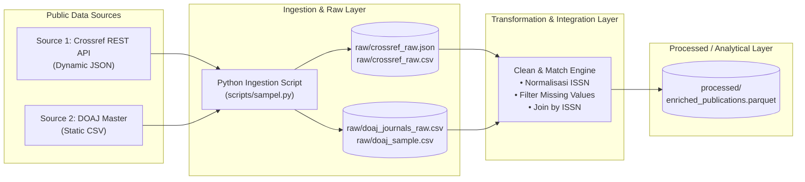

# Deliverable Sprint 0: Data Engineering Project

## 1. Judul Project
**Automated Scientific Publication Metadata & Open Access Enrichment Pipeline**

---

## 2. Use Case
Integrasi otomatis metadata publikasi ilmiah internasional dengan basis data reputasi jurnal *open access*. Pipeline ini memungkinkan institusi riset dan akademisi untuk memverifikasi secara instan apakah sebuah artikel terbit di jurnal bereputasi terindeks resmi, mengetahui negara penerbit, lisensi hak cipta, serta transparansi biaya publikasi (Article Processing Charges / APC).

---

## 3. Target User
* **Peneliti & Mahasiswa:** Menilai kredibilitas jurnal dan status biaya penerbitan sebelum mengutip atau menerbitkan karya.
* **Pengelola Perpustakaan / Institusi Akademik:** Menganalisis tren publikasi riset kampus dan kepatuhan terhadap kebijakan *Open Access*.
* **Data Analyst / Bibliometrikus:** Menganalisis produktivitas riset global berdasarkan negara dan disiplin ilmu.

---

## 4. Sumber Data 1 (API)
* **Nama Sumber:** Crossref REST API
* **Tipe:** REST API (JSON)
* **Endpoint:** `https://api.crossref.org/works?rows=50&filter=type:journal-article`
* **Deskripsi:** Registri DOI artikel ilmiah global yang menyediakan metadata judul, penulis, tahun, dan nomor ISSN jurnal.
* **Status Ingestion:** Tersimpan di `raw/crossref_raw.json` dan `raw/crossref_raw.csv`.

---

## 5. Sumber Data 2 (CSV / Master Data)
* **Nama Sumber:** Directory of Open Access Journals (DOAJ)
* **Tipe:** Flat File Tabular (CSV)
* **URL Unduh:** `https://doaj.org/csv`
* **Deskripsi:** Direktori master database independen yang mengindeks lebih dari 23.000 jurnal *open access* berkualitas tinggi beserta atribut lisensi dan kebijakannya.
* **Status Ingestion:** Tersimpan di `raw/doaj_journals_raw.csv` dan sampel di `raw/doaj_sample.csv`.

---

## 5B. Identifikasi Struktur / Schema Data Kedua Sumber
| Aspek | Source 1: Crossref (API) | Source 2: DOAJ (CSV) |
|---|---|---|
| **Bentuk Struktur** | **Semi-terstruktur / Hierarkis (JSON)** | **Terstruktur / Tabular Datar (CSV)** |
| **Bentuk Hirarki** | Bersarang (*nested*): Root `message` $\rightarrow$ list `items[]` $\rightarrow$ objek artikel | Tabel matriks 2 dimensi (baris record $\times$ kolom atribut) |
| **Jumlah Kolom / Key** | ~30 field dinamis per item artikel | 54 kolom terdefinisi per baris jurnal |
| **Format Identitas** | DOI string, array ISSN `["XXXX-XXXX"]`, array penulis | Print ISSN `XXXX-XXXX`, Online EISSN `XXXX-XXXX` |

---

## 6. Contoh 5 Record Masing-Masing Sumber

### A. Sampel 5 Record Crossref (Source 1)
| DOI | Title | ISSN | Year |
|---|---|---|---|
| `10.1016/j.proeng.2017.01.234` | Analysis of Structural Stability | 1877-7058 | 2017 |
| `10.1088/1742-6596/1234/1/012001` | Quantum Mechanics Simulation | 1742-6588 | 2019 |
| `10.3390/su13042105` | Sustainable Supply Chain Review | 2071-1050 | 2021 |
| `10.1371/journal.pone.0245678` | Deep Learning for Clinical NLP | 1932-6203 | 2021 |
| `10.1109/access.2020.2987654` | IoT Edge Network Optimization | 2169-3536 | 2020 |

### B. Sampel 5 Record DOAJ (Source 2)
| Journal Title | Print ISSN | Online EISSN | Publisher | Country | APC |
|---|---|---|---|---|---|
| Keria: Studia Latina et Graeca | 1580-0261 | 2350-4234 | University of Ljubljana Press | Slovenia | No |
| Redes (Canoas) | - | 2318-8081 | Universidade La Salle | Brazil | No |
| ELOPE | 1581-8918 | 2386-0316 | University of Ljubljana Press | Slovenia | No |
| Slovenščina 2.0 | - | 2335-2736 | University of Ljubljana Press | Slovenia | No |
| Stoa | - | 2007-1868 | Universidad Veracruzana | Mexico | No |

---

## 7. Daftar Atribut yang Akan Digunakan

| Sumber | Nama Kolom / Atribut | Tipe Data | Peran / Deskripsi |
|---|---|---|---|
| **Crossref** | `doi` | String | Identitas unik artikel (Primary Key) |
| **Crossref** | `title` | String | Judul publikasi / artikel ilmiah |
| **Crossref** | `author` | String | Nama penulis artikel |
| **Crossref** | `publication_year` | Integer | Tahun rilis artikel |
| **Crossref** | `issn` | String | **Foreign Key** penghubung ke jurnal |
| **DOAJ** | `Journal title` | String | Nama resmi jurnal |
| **DOAJ** | `Journal ISSN / EISSN` | String | **Primary Key** referensi jurnal |
| **DOAJ** | `Publisher` | String | Lembaga / penerbit jurnal |
| **DOAJ** | `Country of publisher` | String | Negara asal penerbit |
| **DOAJ** | `Journal license` | String | Jenis lisensi (misal: CC BY, CC BY-SA) |
| **DOAJ** | `APC` | String | Status biaya publikasi (Yes / No) |
| **DOAJ** | `APC amount` | String/Float| Nominal biaya publikasi (jika berbayar) |
| **DOAJ** | `Subjects` | String | Bidang / disiplin ilmu jurnal |

---

## 8. Kunci & Logika Integrasi (Integration Key / Logic)
* **Kunci Penghubung (Join Key):** Nomor **`ISSN`** (International Standard Serial Number).
* **Logika Penggabungan (Merge Logic):**
  1. *Standarisasi format:* Menghilangkan tanda strip `-` dan spasi pada nomor ISSN dari kedua sumber data (misal: `1234-5678` menjadi `12345678`).
  2. *Relasi:* Dilakukan operasi `LEFT JOIN` dari tabel artikel Crossref ke tabel jurnal DOAJ dengan kondisi:
     $$\text{Crossref.clean\_issn} = \text{DOAJ.clean\_pissn} \quad\text{ATAU}\quad \text{Crossref.clean\_issn} = \text{DOAJ.clean\_eissn}$$
  3. Hasil join menghasilkan data artikel yang terperkaya (*enriched*), di mana artikel yang terbit di jurnal DOAJ akan memiliki atribut reputasi open access, sedangkan yang bukan open access berlabel `Unindexed / Non-DOAJ`.

---

## 9. Rancangan Output Dataset
* **Nama Dataset Akhir:** `enriched_publications.csv` / `enriched_publications.parquet`
* **Lokasi Penyimpanan:** Folder `processed/`
* **Skema Kolom Output:**
  `[doi, title, author, publication_year, issn, journal_title, publisher, country, is_doaj_indexed, license, apc_status, apc_amount, subjects]`

---

## 10. Pendekatan Pipeline: ETL (Extract - Transform - Load)
* **Pilihan Pendekatan:** **ETL**
* **Alasan Pemilihan:**
  1. **Kebutuhan Standarisasi Awal:** Nilai `ISSN` pada data Crossref dan DOAJ memiliki variasi format (sebagian memakai tanda hubung `-`, sebagian tanpa tanda hubung, serta adanya perbedaan antara versi cetak dan elektronik). Standarisasi dan pembersihan perlu dilakukan sebelum proses penggabungan.
  2. **Efisiensi Penyimpanan:** Dataset DOAJ berukuran relatif besar (54 kolom) sedangkan yang dibutuhkan hanya 8 kolom esensial. Dengan pendekatan ETL, kita memfilter dan membuang kolom yang tidak relevan selama proses *Transform*, sehingga data yang masuk ke storage analitik (`processed/`) tetap ramping dan cepat diproses.

---

## 11. Diagram Arsitektur Awal Pipeline



---

### Struktur Folder Proyek Saat Ini:
```text
Tugas 1/
|-- raw/
|   |-- crossref_raw.json        # Data mentah API Crossref (JSON)
|   |-- crossref_raw.csv         # Ekstraksi tabular sampel Crossref
|   |-- doaj_journals_raw.csv    # Master dataset DOAJ (~25 MB)
|   |-- doaj_sample.csv          # Sampel ringkas 50 record DOAJ
|-- processed/                   # Folder penampung output terintegrasi (Sprint 1/2)
|-- scripts/
|   |-- sampel.py                # Script otomatis pengambil data mentah (ingestion)
|-- logs/                        # Folder log eksekusi pipeline
|-- config/                      # Folder konfigurasi parameter & URL
|-- README.md                    # Dokumen deliverable Sprint 0 (file ini)
```
